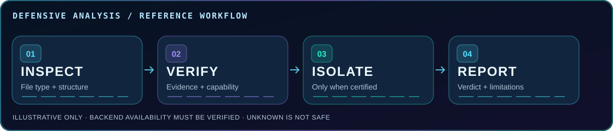

<div align="center">

<a href="https://malguard.github.io/">
  
</a>

### Security starts with evidence, not assumptions.

**Game-mod security** &nbsp; · &nbsp; **Defensive engineering** &nbsp; · &nbsp; **Fail-closed design**

[**Official Website ↗**](https://malguard.github.io/) &nbsp; • &nbsp; [**Documentation ↗**](https://malguard.github.io/docs.html) &nbsp; • &nbsp; [**Security Core ↗**](https://github.com/MalGuard/malguard-core)

</div>

---

## 🛡️ Meet MalGuard

**MalGuard** is an open-source defensive security project focused on helping people inspect potentially risky game modifications. Our main product focus is **GTA Guard**.

We build around a simple principle: **unknown does not mean safe**. A clean static scan cannot guarantee that a file is harmless, and a sandbox check must not be marked complete if its isolation requirements were not met.

<table>
  <tr>
    <td align="center" width="33%">
      <h3>🔍 Inspect</h3>
      <p>Examine file types, archives, scripts and executables with bounded input handling.</p>
    </td>
    <td align="center" width="33%">
      <h3>🧱 Verify isolation</h3>
      <p>Require evidence of an available and suitable isolation backend before any isolated execution.</p>
    </td>
    <td align="center" width="34%">
      <h3>⚖️ Report</h3>
      <p>Separate <code>SAFE</code>, <code>SUSPICIOUS</code>, <code>MALICIOUS</code> and <code>INCONCLUSIVE</code> findings.</p>
    </td>
  </tr>
</table>

## 🎮 Featured project: GTA Guard

> A security-focused approach to reviewing GTA game modifications, plugins and related files. Designed to help users make informed decisions, not to promise that every threat will be detected.

**Project links:** [GTA Guard](https://github.com/MalGuard/GTA-guard.github.io) · [MalGuard Core](https://github.com/MalGuard/malguard-core) · [Website](https://malguard.github.io/)

## ⚡ Our analysis philosophy



```text
UNTRUSTED INPUT
       |
       v
  FILE INSPECTION
       |
       v
  CHECK EVIDENCE + CAPABILITY
       |
       +-- required isolation unavailable --> INCONCLUSIVE / FAIL CLOSED
       |
       v
  CAUTIOUS SECURITY VERDICT
       |
       v
  TRANSPARENT REPORT
```

**Engineering priorities:** verified evidence · safe synthetic testing · privacy-conscious design · explicit failure states · maintainability · regression checks.

## 📂 Explore our work

| Repository | Focus |
| :--- | :--- |
| [**malguard-core**](https://github.com/MalGuard/malguard-core) | Defensive scanners, isolation architecture and security checks |
| [**malguard.github.io**](https://github.com/MalGuard/malguard.github.io) | Public website, project information and documentation |
| [**GTA-guard.github.io**](https://github.com/MalGuard/GTA-guard.github.io) | GTA Guard web presence |
| [**malware-ai**](https://github.com/MalGuard/malware-ai) | Related security and AI development |
| [**MalGuard**](https://github.com/MalGuard/MalGuard) | This animated GitHub profile |

## 🤝 Responsible collaboration

Thoughtful contributions and careful security review are welcome. Please consult [CONTRIBUTING.md](https://github.com/MalGuard/malguard-core/blob/main/CONTRIBUTING.md), [SECURITY.md](https://github.com/MalGuard/malguard-core/blob/main/SECURITY.md) and [PRIVACY.md](https://github.com/MalGuard/malguard-core/blob/main/PRIVACY.md) in the core project.

**Please do not submit live malware to issues or CI, or publicly disclose unpatched vulnerabilities.**

<div align="center">

---

### Build defensively. Verify relentlessly. Report honestly.

[Website](https://malguard.github.io/) &nbsp; · &nbsp; [Documentation](https://malguard.github.io/docs.html) &nbsp; · &nbsp; [Source Code](https://github.com/MalGuard/malguard-core)

<sub>The animations are illustrations, not live security scans, product certifications or real-time telemetry.</sub>

</div>
