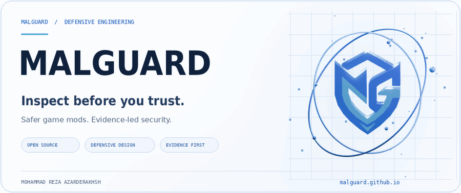

<a href="https://malguard.github.io/">
  <picture>
    <source media="(prefers-reduced-motion: reduce) and (max-width: 600px)" srcset="./assets/malguard-light-3d-mobile-poster.png" />
    <source media="(prefers-reduced-motion: reduce)" srcset="./assets/malguard-light-3d-poster.png" />
    <source media="(max-width: 600px)" srcset="./assets/malguard-light-3d-mobile.gif" />
    
  </picture>
</a>

[**Website**](https://malguard.github.io/) &nbsp; · &nbsp; [**Security Core**](https://github.com/MalGuard/malguard-core) &nbsp; · &nbsp; [**Documentation**](https://malguard.github.io/docs.html) &nbsp; · &nbsp; [**Trust Center**](https://malguard.github.io/trust.html)

<picture>
  <source media="(max-width: 600px)" srcset="./assets/about-mobile-light.svg" />
  
</picture>

من محمدرضا هستم، سازندهٔ <strong>MalGuard</strong>. ابزارهای دفاعی برای بررسی فایل‌ها و مودهای بازی می‌سازم؛ با تمرکز بر شواهد روشن، حریم خصوصی و تصمیم‌گیری آگاهانه. هدفم ساده است: <strong>قبل از اعتماد، بررسی کن.</strong>

### Selected work

  
  

  
  

### How I approach security

<picture>
  <source media="(max-width: 600px)" srcset="./assets/principles-mobile-light.svg" />
  
</picture>

**Unknown does not mean safe.** A clean scan cannot prove that a file is harmless. If required isolation is unavailable, the result must reflect that uncertainty.

<strong>More about the work</strong>

MalGuard is an open-source defensive security project focused on safer game-mod analysis, local scanning and fail-closed isolation. **GTA Guard** is the first product focus.

- **Inspection:** file types, archives, scripts and executables, with bounded input handling.
- **Integrity:** runtime package verification, signed-update enforcement and release provenance.
- **Isolation:** explicit capability checks and fail-closed routing.
- **Development:** harmless synthetic fixtures, regression checks and reviewed contributions.

Explore [MalGuard Core](https://github.com/MalGuard/malguard-core), the [website source](https://github.com/MalGuard/malguard.github.io), and [GTA Guard's web repository](https://github.com/MalGuard/GTA-guard.github.io).

[Contribute](https://github.com/MalGuard/malguard-core/blob/main/CONTRIBUTING.md) &nbsp; · &nbsp; [Responsible disclosure](https://github.com/MalGuard/malguard-core/blob/main/SECURITY.md) &nbsp; · &nbsp; [Privacy](https://malguard.github.io/privacy.html)

The animation is original brand artwork, not live scan telemetry.

